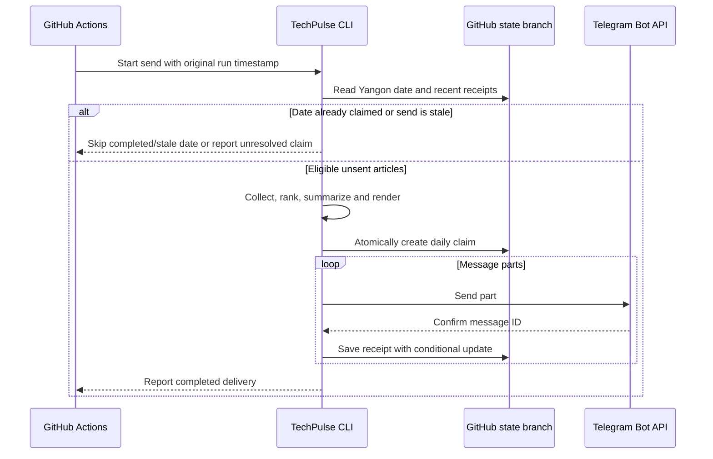

# TechPulse AI architecture

The CLI uses one collection and ranking pipeline for command-line previews, scheduled digests, and interactive Telegram news. The collection registry lives in `feeds.toml`, and career interests and diversity limits live in `preferences.toml`.

## Data flow

```mermaid
flowchart LR
    HN["Hacker News API"]
    RSS["Publisher RSS and Atom"]
    Releases["Public GitHub Releases"]
    Collect["Collect and validate"]
    Rank["Rank, deduplicate and apply diversity limits"]
    Evidence["Collect publisher excerpts"]
    AI["Opt-in Groq or Gemini Free tier"]
    Validate["Validate Burmese output and source evidence"]
    Render["Render digest and original links"]
    Preview["Local or Actions preview"]
    Daily["Daily delivery coordinator"]
    Ledger["GitHub state branch or local SQLite"]
    Telegram["Telegram Bot API"]
    Poll["Local foreground poller"]
    Interactive["Authorized commands and cached news"]
    Preferences["Local interactive SQLite"]

    HN --> Collect
    RSS --> Collect
    Releases --> Collect
    Collect --> Rank
    Rank --> Evidence
    Evidence --> AI --> Validate --> Render
    Rank -->|"AI off or no valid summary"| Render
    Render --> Preview
    Render --> Daily
    Daily <--> Ledger
    Daily --> Telegram
    Telegram --> Poll --> Interactive
    Interactive -->|"News request"| Collect
    Rank -->|"Headlines and original links"| Interactive
    Interactive <--> Preferences
    Interactive --> Telegram
```

Ingestion keeps upstream links and timestamps. Feed descriptions and release notes provide bounded source excerpts. A structured AI response passes validation before rendering. The client verifies limits, supported source evidence and numbers, and preserves the original link. These checks reduce errors and still permit occasional semantic mistakes, so the source remains available to the reader.

Interactive requests use the same ranking without inference. The local poller validates both chat and sender, checks command age, and commits the offset before replying. If it stops after saving an offset but before completing a reply, the user can send a new command. Interactive preferences and bookmarks are stored separately from delivery receipts.

## Daily delivery sequence

A rejected rate-limited request can be retried within the configured wait. A timeout, server error, or receipt-write failure can leave a message that Telegram accepted without a durable acknowledgment. The daily claim remains for review. Use the [recovery runbook](deployment.md#recover-a-failed-delivery) to reconcile the chat before clearing any claim.

## Security boundaries

- Publisher content is untrusted. Collectors validate links and dates, strip feed HTML from evidence, and leave linked articles at their publishers. Prompts treat titles and excerpts as data. Telegram formatting escapes titles and links.
- CI has read-only repository access and runs without bot credentials. The daily send job alone needs write access to the state branch and read access to run metadata.
- The state branch stores delivery dates, opaque fingerprints, and Telegram message IDs. It omits the bot token, chat ID, source text, and subscriber preferences. Treat the branch as repository-visible data.
- The poller runs in the foreground locally. Its database contains hashed reader identifiers and only the preferences and bookmarks readers save.
