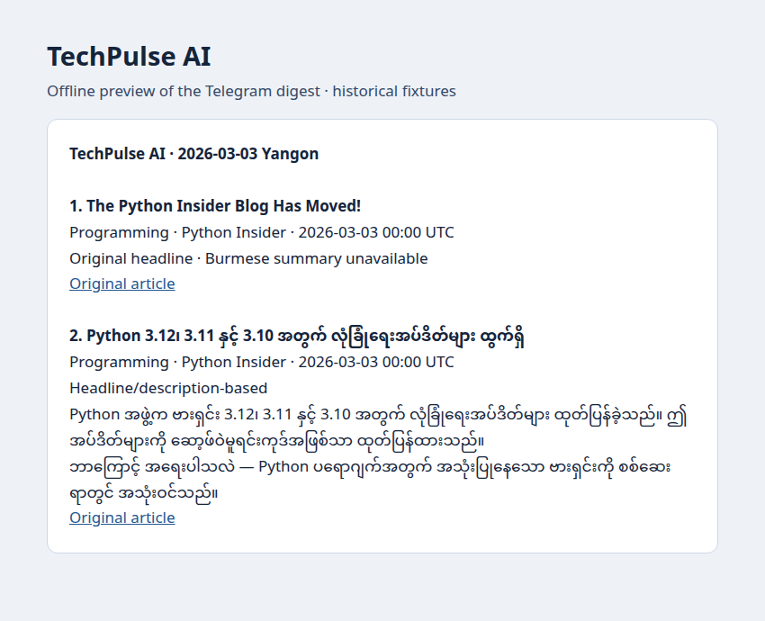

# Portfolio demonstration

## 日本語概要

TechPulse AI は、Hacker News、公式の技術ブログ、GitHub Releases から情報を収集し、Python、FastAPI、React、Odoo、日本の IT 業界への関心に合わせて記事を選ぶニュース配信ツールです。毎朝ヤンゴン時間の午前 7 時に Telegram に配信し、設定に応じてミャンマー語の要約と出典リンクを表示します。GitHub Actions と配信記録を使って、再実行時の重複送信を防ぎます。対話機能は手元の端末で実行できます。

## Reproduce the demo

```sh
python -m scripts.demo
python -m scripts.demo --check
python -m scripts.demo --benchmark 1000
```

The demo reads historical fixtures from two Python Insider announcements and runs the production ranking, summary validator, and digest renderer. It includes a source-backed Burmese review sample and a headline-only fallback. It uses no credentials and makes no network requests. The rendered image is an offline view of the Telegram payload and contains no real chat data. [Python release announcement](https://blog.python.org/2026/03/python-31213-31115-31020/) · [Python Insider migration announcement](https://blog.python.org/2026/03/the-python-insider-blog-has-moved/)



To regenerate the preview HTML, run `python -m scripts.demo --html > /tmp/techpulse-preview.html`. Open it locally, then capture the preview at a desktop width. Keep real customer chats, credentials, usernames, and identifiers out of screenshots.

## Evidence and limits

- **Offline fixture coverage:** Three candidates produced two distinct stories from one publisher. One intentional tracking-URL duplicate was removed. Both selected stories match the configured Python interest. The fixture has one validated Burmese sample and one original-headline fallback. API requests, delivered messages, and inference spend are all zero for this replay.
- **Runtime:** The local fixture averaged 0.299 ms over 1,000 ranking, validation, and rendering iterations on CPython 3.12.3. The measurement excludes network latency, inference, workflow startup, and delivery. Use `--benchmark` to measure it in your environment.
- **Live checks observed during development:** A Phase 3 dry run selected six stories across three sources and rendered one validated Groq summary. A Phase 2 manual run received one successful Telegram API acknowledgment for a digest. Neither observation is a production delivery success rate.
- **Burmese review:** The demo sample preserves the release series and says the updates were distributed as source. It is an example for human review. No independent/native-speaker quality score or aggregate factual-accuracy metric has been measured.
- **Production measurements:** After deployment, use successful scheduled delivery runs divided by all scheduled runs that actually started for delivery success. Track skipped schedules separately. Record source counts and selected interests from the dry-run explanation, duplicate matches using URL/title fingerprints, and inference requests and spend from the provider's usage view. Keep identifiers out of the measurement notes. A sustained sample of scheduled runs has not been gathered in this repository.

See [architecture](architecture.md) for component and delivery diagrams, and the [deployment guide](deployment.md) for the rollout and recovery checks.
